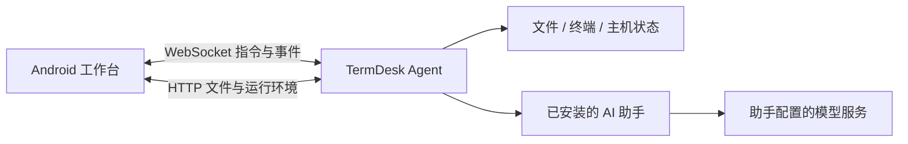

# TermDesk

**把电脑上的 AI 工作带到手机，也能在手机本机处理文件与终端。**

TermDesk 是一个 Android 工作台。你可以选择运行设备和已安装的助手，继续会话、查看执行过程、回答权限请求，再检查或取回工作产物。手机负责交互，实际工作由所选设备上的代理与助手完成。

当前版本：**1.0.0**，首个正式发行版本，采用 APK 侧载分发。能力取决于设备环境和助手接口；“检测到助手”不等于已登录、已配置模型或所有功能都可用。

发行范围、安装说明及验证结果见 [v1.0.0 发行说明](documents/releases/1.0.0.md)。电脑端提供设备、助手与会话管理控制台。

## 从哪里开始

| 你想了解什么 | 阅读入口 |
|---|---|
| 项目解决什么问题、适合谁 | [项目介绍](documents/项目介绍.md) |
| 有哪些功能、哪些还没做 | [功能清单](documents/功能清单.md) |
| 如何启动、配对和构建 | [运行与开发](documents/运行与开发.md) |
| 模块如何协作、数据如何流动 | [架构设计](documents/架构设计.md) |
| 本轮界面与交互有哪些规则 | [移动端设计说明](documents/移动端设计说明.md) |
| Redmi 上实际验证了什么 | [0.33 演示版验收](documents/archive/2026-10/演示版验收-2026-10-17.md) |

## 能做什么

- **继续 AI 工作**：新建会话、读取历史、查看流式输出与工具过程；能否恢复历史由助手能力决定。
- **处理文件**：浏览、搜索、上传下载，编辑文本；离开前提醒未保存修改，保存后等待设备确认。
- **使用终端**：在所选设备上保持 shell 会话，查看输出、停止运行、切换或关闭终端。
- **查看设备**：主机指标、进程与服务；Android 仅展示系统允许读取的信息，受限数据给出明确说明。
- **切换运行位置**：远程电脑，或安装运行环境后的手机沙盒。两者的目录、助手和会话分别管理。

TermDesk 不附带模型服务，安装 App 不会自动获得 AI 能力。模型账号、服务商和费用由对应助手管理。本机运行指代理和工具运行在手机内；模型仍可能访问外部服务。

## 第一次运行

电脑需要 **Node.js 20 或更新版本**。在仓库根目录执行：

```powershell
npm ci --prefix pc-agent
node pc-agent/src/server.js --host 0.0.0.0
```

1. 在电脑上打开 [配对页](http://127.0.0.1:7420/pair)。
2. 安装正式发行的 APK，或自行构建；更新时使用相同签名。
3. 手机与电脑处于可互通的网络时，扫描配对页二维码；系统会把配对链接交给 App。也可在设备管理页填写地址与凭据。
4. 回到工作台，选择可用助手和工作目录，再新建会话。

需要手机操作电脑终端时，显式增加 `--enable-shell`。公网入口配置见[运行与开发](documents/运行与开发.md)。根目录 `TermDesk.bat` 开启终端并按本机配置尝试中转；隧道需显式增加 `--tunnel`。

**手机运行环境另行安装**：连接提供载荷的电脑后，进入“设置 → 运行设备与助手”，选择“这台手机”后下载安装运行环境。运行环境与 AI 助手分开安装；没有助手时，文件和终端仍可使用。手机端 Agent 配置仍待设计，原电脑 Codex 配置入口暂时隐藏。详见[本地内核方案](documents/本地内核方案.md)。

## 工作原理



Agent 可以运行在电脑，也可以随 App 解包后运行在手机沙盒。两种模式使用同一份 Node 源码和协议。Codex 使用 app-server，DSH 使用 SDK，ACP 助手使用共享适配器；CLI 助手通过已验证的契约接入。差异见[功能清单](documents/功能清单.md)。

## 构建 Android

准备 JDK 17+（本轮使用 JDK 21）、Android SDK 35 和 Node 依赖后，在仓库根目录执行：

```powershell
.\android\gradlew.bat -p android :app:testDebugUnitTest :app:assembleDebug
```

产物：`android/app/build/outputs/apk/debug/app-debug.apk`。构建会把代理源码和 `ws` 同步到 APK；内容指纹用于在保留应用数据的更新安装后刷新本机代理。

调试包与正式包签名不同，更新必须使用相同签名。不要用卸载来规避签名冲突，否则会丢失手机内的凭据、草稿和沙盒文件。

## 开发与验证

```powershell
npm ci --prefix relay
npm --prefix pc-agent test
.\android\gradlew.bat -p android :app:testDebugUnitTest
```

默认代理测试使用纯函数、合成协议或假助手；完整套件同时需要 relay 测试依赖，其他工具要求见[运行与开发](documents/运行与开发.md)。真实模型验证必须遵守[开发约束](documents/开发约束.md)，先获得使用者对助手与模型的许可。

没有真机时，可使用已布置的[安卓 UI 测试环境](documents/安卓UI测试环境.md)做界面回归；它不能替代手机本机能力验收。

## 仓库结构

| 目录 | 用途 |
|---|---|
| `android/` | Kotlin / Jetpack Compose 手机客户端 |
| `pc-agent/` | Node.js 代理、协议、助手适配器与测试 |
| `desktop/` | Compose Desktop 代理控制窗口 |
| `relay/` | 可选的设备配对与反向连接服务 |
| `plugins/` | 配套实验插件 |
| `documents/` | 当前设计、使用说明、历史决策和验收证据 |

## 当前边界

- 本机沙盒需要兼容载荷和可执行环境；本版重点验证 ARM64 Android，不能宣称所有手机都兼容。
- 为执行应用私有目录内的运行环境，默认 `targetSdk` 为 28。这是侧载方案，存在平台兼容与分发限制，不是可直接提交应用商店的版本。
- DSH 支持当前运行期连续对话，尚未承诺代理重启后的原生历史恢复。不同助手的模型设置、取消、历史正文和审批能力也不相同。
- 已认证客户端可同时观察会话事件，写入受控制权检查；缓存和发送队列尚未完全按每台电脑隔离，不能宣称多端并发编辑已完整实现。
- 终端以宿主用户权限运行，文件访问受配置目录限制；这不是针对恶意代码的强隔离执行平台。

后续设计和缺口见[架构设计](documents/架构设计.md)与[功能清单](documents/功能清单.md)。历史文档保留原日期，不能替代当前能力说明。
