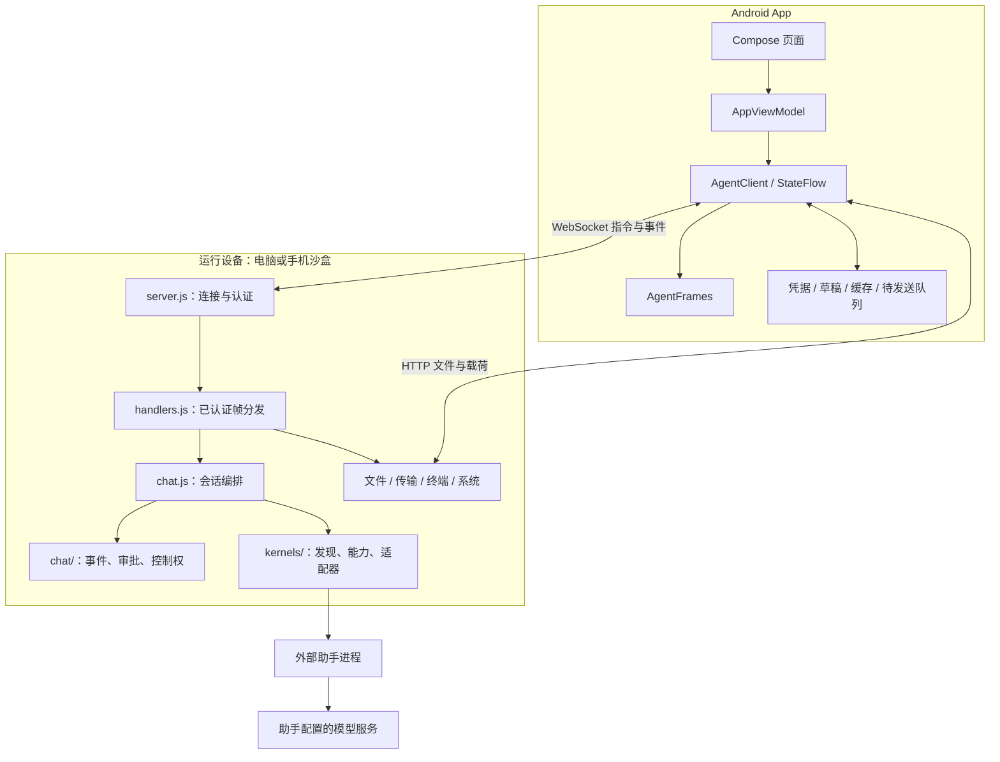
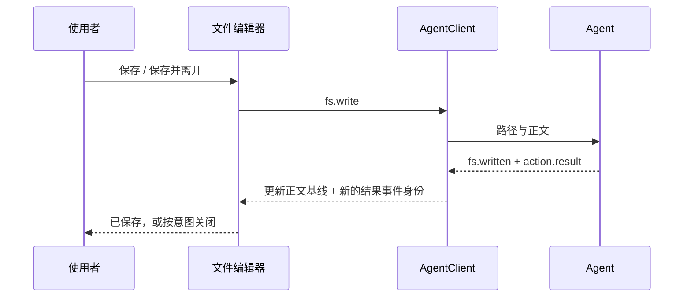

# TermDesk 架构设计

> 1.0.0，2026-10-17。本文先描述当前代码，再列目标设计。路线图不是已经完成的目录结构或能力。

## 1. 系统职责

TermDesk 将移动交互与工作执行分开。Android 负责选择运行设备、展示状态与输入；Agent 负责认证、文件、终端和助手生命周期；助手负责模型连接与原生会话语义。

手机沙盒运行同一份代理源码。它只是另一种宿主：路径、shell 和系统权限不同，不能继承电脑上的可用性判断。

## 2. 当前模块边界

| 层 | 主要源码 | 职责 |
|---|---|---|
| Android 生命周期 | `MainActivity.kt`、`AppRoot.kt` | 系统栏、深链、页面入口、通知与前后台状态 |
| Android 展示 | `ui/*Section.kt`、`AppShell.kt` | 工作台、会话、文件、终端、系统、设置及导航 |
| Android 编排 | `AppViewModel.kt` | 页面动作、偏好、所选目标与领域状态映射 |
| Android 连接 | `data/AgentClient.kt` | WebSocket、重连、请求、StateFlow、传输与队列协调 |
| 协议解析 | `AgentFrames.kt` 与领域数据类 | JSON 转类型、兼容缺字段、能力解析 |
| 本机环境 | `LocalKernel.kt`、`LocalAgent.kt`、服务类 | 载荷安装、校验、解包、代理启动及保活 |
| 服务入口 | `pc-agent/src/server.js` | HTTP/WS 服务、认证、生命周期、隧道/中转连接 |
| 帧路由 | `pc-agent/src/handlers.js` | 参数到领域操作、权限守卫、回包 |
| 会话编排 | `pc-agent/src/chat.js` | 创建、发送、恢复、取消、队列、适配器协调 |
| 会话状态 | `chat/chat.js`、`stream.js` | 事件、序号、转录上限、流式预览与正文替换 |
| 审批/控制权 | `chat/approvals.js`、`continuity.js` | 权限请求、超时、owner 租约与写入仲裁 |
| 助手入口 | `kernels/registry.js` | 安装发现、启动参数、接入层级、用户登记 |
| 能力契约 | `kernels/contract.js`、`manifest.js` | 运行能力推导与对外配置声明 |
| 助手适配 | `kernels/codex.js`、`dsh.js`、`acp.js`、`cli.js` | app-server / SDK / ACP / CLI 协议转换 |
| 工作工具 | `files.js`、`transfer.js`、`terminal.js`、`inventory.js` | 文件与传输、shell、进程和服务 |

上表 Android 文件均位于 `android/app/src/main/java/dev/termdesk/app/`。`AgentClient` 与代理分发仍承担较多职责，是下一阶段拆分对象，不能宣称已完成 repository 分层。

## 3. 核心对象与事实来源

| 对象 | 身份与权威来源 | 不应混淆的内容 |
|---|---|---|
| 运行设备 | 手机所选目标、配对电脑标识 | 同一个目录字符串在不同设备上不是同一个目录 |
| Kernel | 设备注册表中的 `id` | 品牌名、PATH 文件存在都不能保证模型可用 |
| Chat | 当前 Agent 内的 `chatId` | 不等同于助手持久化 session/thread id |
| 原生会话 | 助手自己的 session/thread id | 恢复应交给原生接口，不能靠拼接历史冒充 |
| 历史记录 | 助手索引或其明确的记录来源 | 可读不一定可继续；CLI 可能仅有索引 |
| ChatEvent | chat 内序号、kind、内容 | 序号只表示顺序，不能表示旧事件未被修订 |
| Ownership | Agent 的租约记录 | Android 仅展示并请求，不能单方面授予写权限 |
| ActionResult | 一次操作结果及客户端事件身份 | 相同文案的两次结果仍是两次交付 |

## 4. 连接与配对

1. Agent 监听指定地址。手机通过扫码深链或手工输入取得地址与凭据。
2. WebSocket 升级后先发送认证帧。服务端在认证后执行协议版本协商。
3. `auth.ok` 声明版本与可选能力；客户端按能力决定使用 `chat.sync`，旧代理回退 `chat.read`。
4. 断线后保留可查看内容并重连。切换运行目标时清理旧目标的瞬时状态，恢复各自偏好。

直连支持设备凭据及兼容的主令牌；中转使用一次性配对码交换设备凭据。不能把“所有连接都使用一次性配对码”写成统一事实。公网通信需要 TLS；局域网 `ws/http` 自身不加密。

## 5. 会话与事件同步

### 当前决定：按需全量校准

日常更新走 `chat.event`、`chat.status`、`chat.turn` 等推送。打开会话、重连或窗口回到前台时，请求一份权威快照；不每 60 秒重传全文。

`chat.sync` 与 `chat.read` 都返回完整的保留事件窗口，`eventSync.mode` 为 `full`，`complete: true` 仅表示这一窗口已完整返回。它不意味着整段原生历史永久保留。单 chat 最多保留 1,200 个事件，终端输出副本另有 64 KiB 字符上限。

旧事件可能被流式正文替换或删除，且序号不增加。因此本版删除基于 `afterSeq` 的 delta 分支和 Android 合并分支；旧调用者发送游标也得到 full。没有下发无人消费的 continuity/eventCursor/oldestEventSeq 字段。

未来若采用增量同步，协议必须同时表达：新增事件、旧事件修订、删除标记、窗口截断、快照版本以及客户端确认。只有新序号不能满足这些条件。

### 发送与离线

客户端保存未确认发送，服务端通过请求标识去重/确认，恢复连接后按顺序重放。Android 当前本机与远程队列分开，但远程尚未完全按每台电脑隔离。历史缓存总预算为 48 MiB，单份大快照另有限制。

## 6. 多设备写入

Agent 的 `ChatContinuity` 管理 owner 与租约。七条写入路径在进入业务修改前检查控制权：发送、关闭、审批、配置、取消、终端输入和终端停止。

- 当前 owner 可以续租；原 owner 对其运行中回合可恢复操作权。
- 其他设备不能强抢运行中的回合，即使租约已经超时。
- 空闲会话可按规则接管，观察者收到明确拒绝结果。

服务端维护已认证连接集合，将会话事件送往所有观察端，列表中的 ownership 按接收者计算。普通终端输出只发给打开了对应终端的连接，会话终端输出只发给订阅了该会话终端的连接；一个观察端退出不影响其他端。写入仍受 owner 检查，并不因广播放宽权限。

通知面向手机及兼容客户端，桌面观察端不接收或确认手机通知；无人接收时继续暂存。通知仍为有界共享队列，多个手机各自独立的持久化确认尚未实现。设备吊销或移除按认证所得的凭据记录定位连接，同步移除操作权限后执行 4401 断连；HTTP 文件及运行环境接口复用有效设备凭据校验。

新配对使用服务器验证的设备记录 ID，客户端不能通过自报 deviceId 冒充另一台手机；使用旧主令牌的兼容客户端仍可报告稳定身份，身份隔离不等于分级管理授权。

## 7. 助手发现与能力

发现依次考虑内置接入、`~/.termdesk/kernels/*.json` 和环境登记，并解析当前设备 PATH/PATHEXT。Node 托管脚本分别检查运行时和脚本。POSIX 拒绝 Windows PE 文件；本版明确拒绝直接 `.cmd/.bat` 入口，并给出“脚本类型不支持”，推荐登记可执行文件或 `node + 脚本`。

坏 JSON、缺少 `id/bin`、不支持的 transport 输出配置路径和诊断，不静默消失。可用性表示入口满足启动检查；登录、网络和模型状态仍需实际运行才能得知。

`manifest` 的约束：

- `supported` 必须有实现；`discovered` 必须有运行时发现路径。
- `planned` 只是诚实的路线声明，不代表当前按钮生效。
- ACP 输入模态尚未发现，故为 `planned`；无 transport 的配置 scope 为 `none`。
- registry 的兼容 `resume` 与 manifest 的 `session.resume` 使用同一能力推导。
- 当前 Android 在助手选择中读取会话恢复能力；完整配置表单尚未改为 manifest 驱动。

## 8. 文件保存与失败语义

`ActionResult` 在客户端每次构造时分配单调事件 ID，避免 StateFlow 按值相等丢弃连续同值确认。编辑器保留 20 秒确认超时；离线不能点击保存；失败与超时保留当前草稿。

这不是跨请求事务：未来并行编辑、多个请求在途时，应加入显式写请求标识及文件版本检测。本版 UI 在保存期间禁止再次提交，因此不假装解决并发写冲突。

## 9. 本机运行环境与发布

运行环境载荷与 APK 分开：下载 → 哈希和大小校验 → 解包 → shell 健康检查 → 写安装记录。安装记录不等于 AI 助手已安装。

Agent 源码随 APK 构建同步；内容指纹与 App 版本一起用于刷新已解包副本。`adb install -r` 保留应用数据，故不能只凭版本号决定是否解包。

默认 targetSdk 28 是执行私有目录内 Termux 用户环境的技术取舍。提高 targetSdk 的替代构建会放弃该本机执行方式；应用商店分发需要单独设计。沙盒是 App/OS 权限隔离，不是完整容器或恶意代码隔离。

## 10. 下一阶段目标结构

不在演示版中同时重写架构。按可回归的领域迁移：

1. **协议和领域拆分**：将 handlers 的文件、会话、系统帧路由拆出；保持公开帧与错误语义。
2. **Android repository**：连接生命周期留在 core；文件、会话、终端各自聚合状态与请求，先减少巨型参数列表。
3. **设备作用域存储**：缓存、队列、草稿统一使用稳定设备 ID + chat/native session ID，迁移旧数据。
4. **多端离线恢复**：在已有事件广播与终端订阅上完善逐设备通知确认、断线恢复和修订协议；保持双设备交错消息回归。
5. **能力驱动配置**：区分当前值、可选值、作用域、生效时机及失败原因，先支持已打通字段。

每一步先建立领域边界测试，再迁移调用者。保留旧协议兼容，按明确决策移除遗留分支，不长期维护两套事实来源。

## 11. 验证策略

- 纯函数/解析测试：字段默认值、能力、状态与错误映射。
- 帧级测试：重复保存、控制权拒绝、权威快照、缺失内核。
- 假助手端到端：真实服务与协议、合成模型输出，无计费调用。
- Android 单元测试及 APK 构建：编译与状态交付回归。
- 真机验收：字号、键盘、系统返回、文件落盘、安装与本机代理。
- 真实模型与公网：独立、明确许可后执行，不算入默认离线测试。

具体结果见[演示版验收](archive/2026-10/演示版验收-2026-10-17.md)，未执行的场景不标通过。
