# TermDesk 项目说明书

手机工作入口 · 双执行位置 · 电脑管理控制台

版本：1.0.1-dev.1；日期：2026-10-18。已发行版本仍为 v1.0.0，本说明对应其后的开发与验证。原始构想见[《移动端agent开发》](移动端agent开发.md)，该文档保留原文；本文说明当前实际实现。

## 一、核心定位

TermDesk 是面向 AI 辅助开发与数字内容生产的 Android 工作台。用户在手机上选择运行设备、助手和项目目录，发起或继续工作，查看流式输出、回答权限请求，再编辑、检查或取回产物。执行位置可以是远程电脑，也可以是安装了兼容运行环境的手机沙盒。

项目把三个对象分开：**手机负责交互，Agent 负责设备能力与调度，助手负责模型连接与原生会话**。电脑端定位为管理控制台，用于观察设备、助手、会话和代理状态。它不再复刻一个完整聊天客户端。

### 典型使用过程

1. 电脑启动 Agent，手机通过配对链接或地址与凭据建立连接。
2. 在工作台选定已发现的助手与工作目录。助手需提前安装、登录和配置。
3. 新建会话，查看实时正文与工具执行过程；出现权限请求时作出选择。
4. 打开项目文件、编辑文本并等待保存确认；需要命令时进入该设备的终端。
5. 离开后回到会话，通过权威快照校准状态。是否能继续原生历史由具体助手决定。

适合继续电脑上的开发、检查生成文件、运行明确的项目命令和远程跟进长任务。它不附带模型账号，不把文件名或品牌名当作可用能力，也不承诺任意外部进程都能无损接管。

## 二、功能实现

| 模块 | 已有功能与实现方式 | 当前限制 |
|---|---|---|
| 工作台 | 远程电脑/手机切换；动态助手选择；目录选择；新建与最近会话 | 没有连接或可用助手时不能新建；可执行不等于已登录或有额度 |
| 会话 | 历史索引、正文、流式事件、工具过程、发送/取消及适配器允许的恢复 | 恢复、取消、模型和模式能力按接口分别实现 |
| 权限与控制权 | 统一审批入口；服务端 owner/租约守卫；其他客户端可观察 | 会话主控不等于整台电脑的分级管理授权 |
| 文件 | 浏览、搜索、新建、重命名、删除、文本编辑、上传下载及分片上传 | 访问受 Agent 目录白名单约束；并发编辑尚无文件版本冲突协议 |
| 保存保护 | 未保存离开确认；保存等待设备回包；失败或超时保留草稿 | 当前编辑器串行保存，不是假装完成跨设备写入事务 |
| 终端 | 长驻 shell、持续输出、命令历史、打断、切换和关闭 | Windows 为 PowerShell 管道协议，POSIX 为 bash；不是完整 PTY |
| 系统信息 | 主机指标、进程与平台支持的服务操作 | Android 只能显示系统许可的数据，Windows 服务能力不能搬到手机 |
| 设备连接 | 保存多台电脑、切换、配对、解绑、重连、协议版本检查 | 直连与中转的凭据交换不同；公网需受信任 TLS 通道 |
| 手机运行环境 | 独立下载安装、大小/哈希校验、解包、健康检查、本机 Agent | 运行环境与 AI 助手分开安装；本机模型也可能请求外部服务 |
| 电脑控制台 | 概览、设备管理、助手发现/启用/路径管理、会话观察及控制权状态 | 不作为聊天、文件编辑或终端工作台；安装器另行验收 |

### 配置能力的范围

手机设置中的旧电脑 Codex 编辑入口已隐藏。目标是以后提供手机端 Agent 配置，而不是把某一个品牌的配置当作通用设置。目前 DSH 路由通过运行 Agent 的设备配置，缺少明确供应商、模型或第三方端点时给出未配置错误，不再自动绑定维护者的个人预设。

模型/模式选择必须来自对应助手的真实接口。`supported` 表示有代码路径，`discovered` 表示有发现结果，`planned` 表示未完成路线；不能用 planned 字段生成看似可操作的按钮。

## 三、整体架构

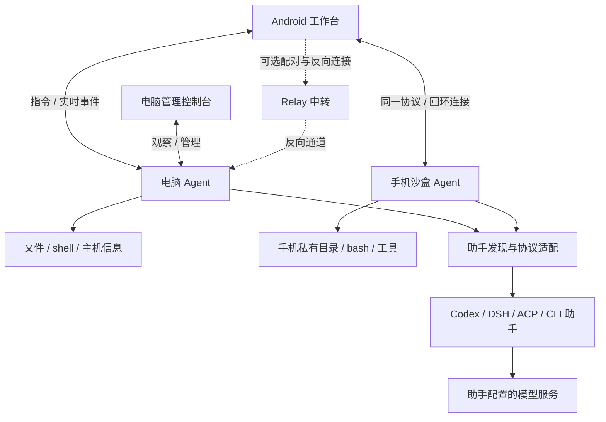

### 各部分的职责

| 层次 | 核心实现 | 负责什么 |
|---|---|---|
| Android 界面 | Jetpack Compose、AppRoot、AppShell、各业务页面 | 导航、输入、状态与反馈，不决定宿主实际能力 |
| Android 状态与连接 | AppViewModel、AgentClient、StateFlow、解析和存储类 | WebSocket 生命周期、请求/回包、草稿、凭据及待发状态 |
| 服务入口 | pc-agent/src/server.js | HTTP/WebSocket、认证、连接集合、事件路由与在线吊销 |
| 业务分发 | handlers.js | 把协议帧交给文件、终端、会话、设备和配置处理器 |
| 会话编排 | chat.js、chat/、kernelruns.js | 事件窗口、审批、控制权、运行生命周期和历史恢复协调 |
| 发现与适配 | kernels/registry.js、contract.js、manifest.js 及各适配器 | 找真实入口，声明可支撑的能力，转换不同助手协议 |
| 宿主工具 | files.js、transfer.js、terminal.js、inventory.js | 真实文件、传输、shell 和系统数据 |
| 管理控制台 | Compose Desktop、WorkbenchStore、AgentApi/AgentSocket | 独立客户端状态、设备/助手/会话管理；复用 Agent 而非另建引擎 |
| 可选中转 | relay/ | 配对与反向运输，不执行 Agent 命令 |

远程和本机模式使用同一份 Node Agent 源码与协议。Android 构建时把源码和所需依赖同步进 APK，再用内容指纹判断是否刷新已解包副本。这解决了覆盖安装保留应用数据时“APK 已更新、本机代理还是旧代码”的问题。

## 四、技术栈与选型

| 部分 | 实际技术 | 选型作用 |
|---|---|---|
| 手机客户端 | Kotlin、Jetpack Compose、Material 3、Coroutines/StateFlow | 原生 Android 导航、状态流、系统文件选择器及后台服务 |
| 电脑管理器 | Kotlin/JVM、Compose Desktop 1.7.3、Skia、JDK 21 | 原生窗口；共享手机主题源码，独立管理端状态 |
| Agent | Node.js 20+、ES modules、ws、内置 HTTP/文件/子进程 API | 统一宿主工具和多类助手接入，便于嵌入手机环境 |
| 网络 | WebSocket 实时帧、HTTP 文件/载荷、可选 TLS 隧道和 Relay | 指令与事件、较大文件传输分别处理 |
| 本机执行 | 重定位 Termux 用户环境、Node、bash 及按需工具 | 在 App 私有目录提供可执行的用户态工具环境 |
| 中转 | Node.js 22+、WebSocket、设备凭据与反向连接 | 电脑主动出站连接，可选部署，不是局域网的前置条件 |
| 持久化 | 手机偏好/加密凭据、文件缓存、Agent 本机 JSON 记录 | 保留连接、草稿、队列和运行元数据；不额外引入数据库服务 |
| 构建验证 | Gradle/Android SDK 35、JUnit、Node assert/node:test、假助手端到端 | 分别验证解析、状态、协议、实际文件和平台行为 |

原始构想中的 Flutter、xterm.dart、SSH 业务通道、FastAPI 中转和 Docker 执行环境没有作为当前主实现交付。当前网络主线是 WebSocket + HTTP，执行层是宿主进程和 Android 用户环境。WSL/Docker 可以辅助开发，但不是用户启动 TermDesk 必须安装的组件。

## 五、助手接入与能力边界

| 接口 | 代表助手 | TermDesk 负责 | 不能统一假定的能力 |
|---|---|---|---|
| app-server | Codex | thread 创建/读取/恢复、事件和审批转换 | 安装、登录、模型额度仍由助手条件决定 |
| SDK | DeepSeek Harness | 明确路由、运行时启动、流式更新和当前运行期连续对话 | 不承诺代理重启后的原生历史恢复；本轮未做真实模型回合 |
| ACP | OpenCode、MiMo、自定义 ACP | 会话、更新、权限、发现到的模型/模式及终端桥接 | 各实现的 load、cancel、模态和工具语义不完全相同 |
| CLI shim | 有已验证契约的命令行助手 | 打印模式、NDJSON、会话 ID 及声明的续聊方式 | 只有索引不等于能读取历史正文；未知 CLI 不自动可用 |

发现优先核查显式路径、宿主 PATH、安装元数据及用户登记。Windows OpenCode 不再依赖维护者的 D 盘安装；npm 入口由包的 bin 声明决定，Node 脚本与原生程序分别启动。直接 `.cmd/.bat` 仍明确拒绝，避免“发现可用、spawn 必失败”。

自定义登记位于运行设备的 `~/.termdesk/kernels/`。发现异常需要说明“未找到”“不可执行”“脚本不支持”或“登记格式错误”，而不是把所有失败都隐藏成没有安装。

## 六、关键业务流程

### 1. 一条消息怎样完成

手机提交带会话身份的发送请求，Agent 先验证连接和写入控制权，再由会话编排选择适配器。助手产生正文、工具或权限事件；Agent 统一事件形状并分发给已认证观察端。手机展示过程，桌面同步观察；只有有权客户端可以修改或回答审批。

审批不是客户端自己显示“已允许”就结束。响应必须传回对应运行中的请求，超时、重复响应、非 owner 操作均由服务端处理。会话关闭、打断、终端输入等写入路径也遵守同一控制权边界。

### 2. 一个文件怎样算保存成功

编辑器提交路径与正文后进入等待状态。设备完成实际写入，返回文件与操作结果；客户端才更新正文基线、大小和“已保存”状态。相同文件连续两次成功也必须是两个结果事件，因此操作结果有独立事件身份，避免 StateFlow 按值相等吞掉第二次确认。

保存失败或 20 秒未获确认时保留修改。“保存并离开”在成功前不能关闭编辑器；并发文件版本检查仍是后续工作，不能把串行保存说成跨设备事务。

### 3. 断线和重新打开怎样恢复

日常更新使用推送；打开会话、重连、回到前台时读取保留窗口的权威完整快照。当前没有每分钟重复拉整份历史，也不宣称只按新事件序号就实现了增量同步。旧事件可能被修订或删除，未来增量协议还必须表达修订、删除、截断和版本。

通知有待确认队列，可在重新连接后补发；桌面观察端不能消费手机通知。多个手机独立、持久化的确认记录尚未完成。不同电脑的缓存和待发队列也尚未完全隔离，应避免把当前实现描述为完整多端并发编辑平台。

### 4. 一个终端属于谁

普通终端输出只发给打开了该终端的连接，会话终端按订阅分发。关闭观察端不会抢走其他设备输出。桌面退出只停止由本窗口启动的代理，不终止外部启动器拥有的进程。终端命令仍以宿主用户权限运行，目录白名单不能约束任意 shell 命令。

## 七、页面与人机交互

手机四个高频入口为工作台、会话、文件和终端；系统和设置放在菜单中。设置及子页、会话详情和输入键盘场景收起主导航，减少输入与阅读遮挡。设备、助手、工作目录是不同的选择，不用“本机”一词掩盖操作目标。

页面需要呈现操作所需的信息：在哪台设备、当前能做什么、是否还在等待、失败后怎样继续。登录状态、模型配置、助手可执行性和手机运行环境安装状态分别表达。网络读取安装包清单失败不能把已装好的运行环境改成“安装失败”。

以下六张为 2026-10-18 在 OPPO PDEM30、Android 13、1080×2376、1.35 倍字号下的真实截图。会话通过真实 Agent/适配器链路，但内容由固定回复助手生成；文件写入和终端命令实际在电脑执行。

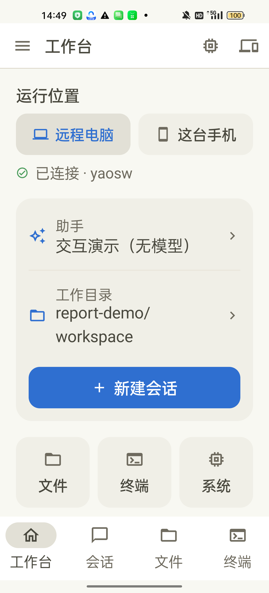
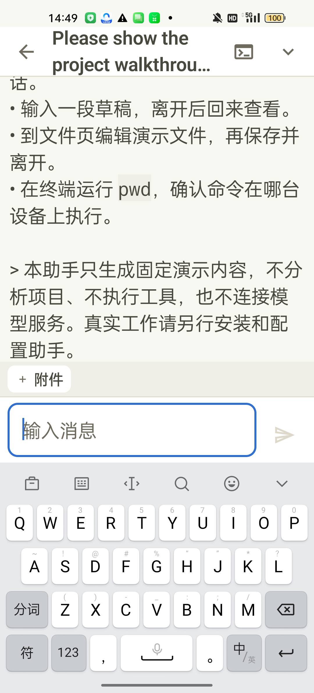

工作台负责确定目标后再开始；会话截图保留真实大字号和输入状态。长标题、长回复与输入法占用空间仍需继续优化，当前 Markdown 引用可见原始符号，不将这些细节掩盖为已经完成。

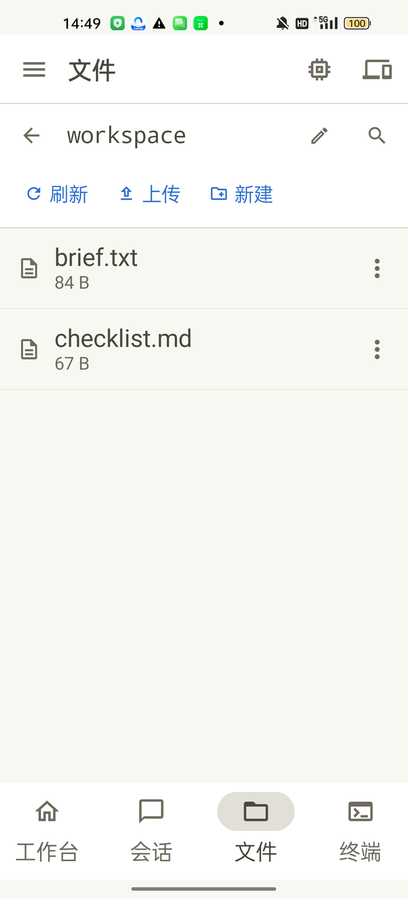
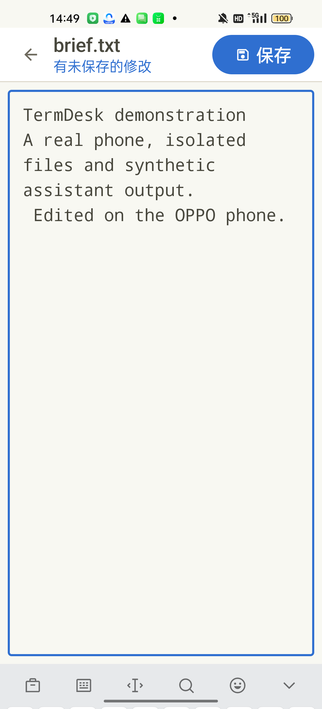

文件列表和编辑页对应同一个电脑工作目录。自动化在手机输入修改，点击保存后重新读取电脑文件，确认修改真实落盘；截图本身展示的是提交前状态，不代替落盘验证。

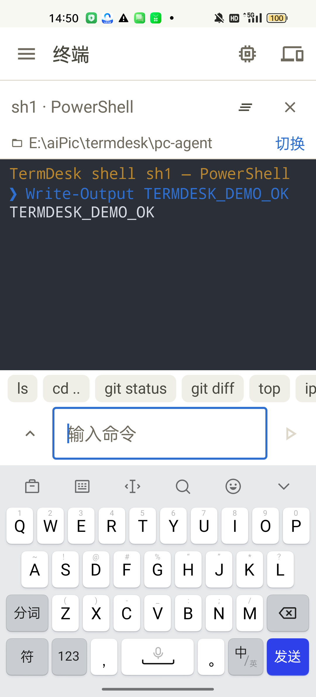
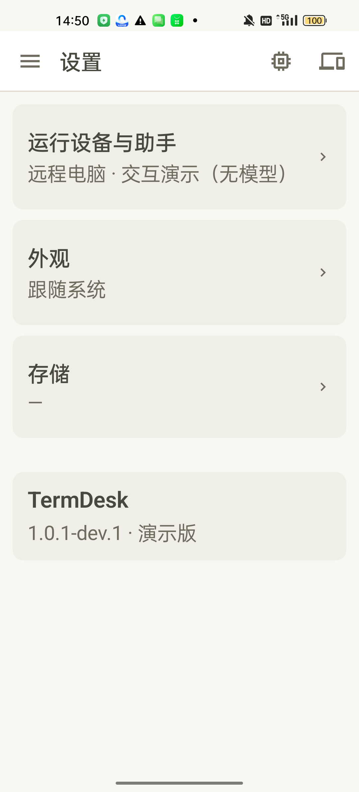

终端显示 shell 类型、实际目录、命令与输出。本次终端初始目录仍是 Agent 所在目录，并未自动继承工作台选定目录，这是后续需要统一的交互点。设置页中的版本与本轮安装版本一致，手机 Agent 通用配置仍未开放。

### 电脑管理控制台

修复精简运行时模块后，实际打开原生 TermDesk.exe 并逐页检查，最后正常关闭。以下为本轮新截图，不是沿用旧演示图。它连接的是另一套隔离协议夹具；手机录屏已经结束，没有把后台脚本伪称为正在连接的手机。

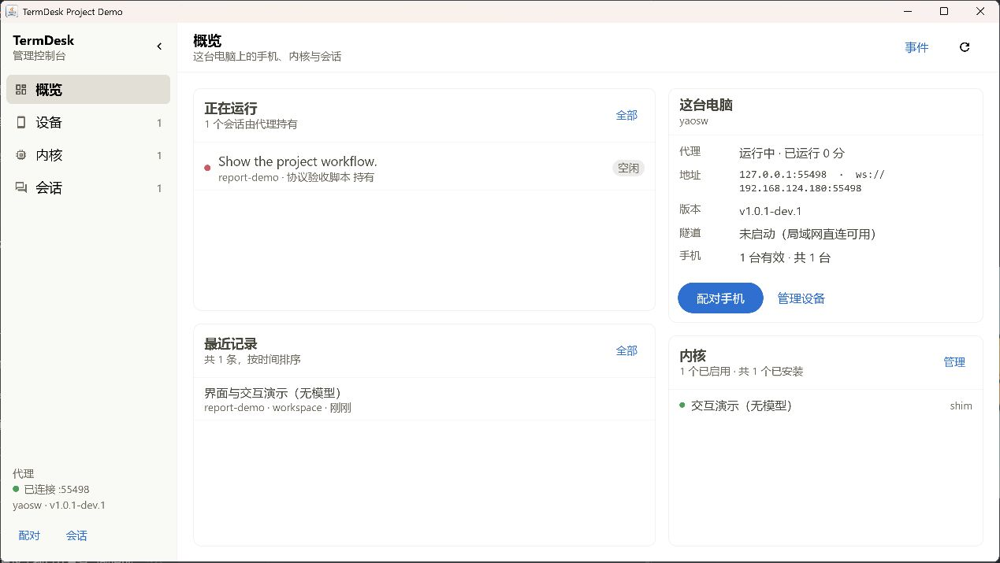
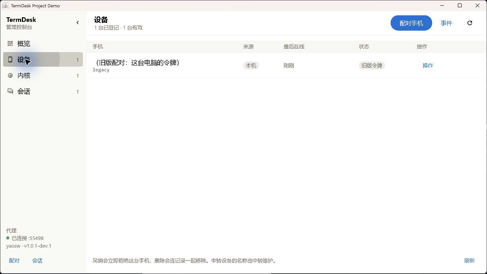

设备页仍将兼容主令牌计入“有效手机”，截图中的 1 条记录实际是测试令牌，不证明存在真实手机在线。这是仍待修复的状态模型问题。

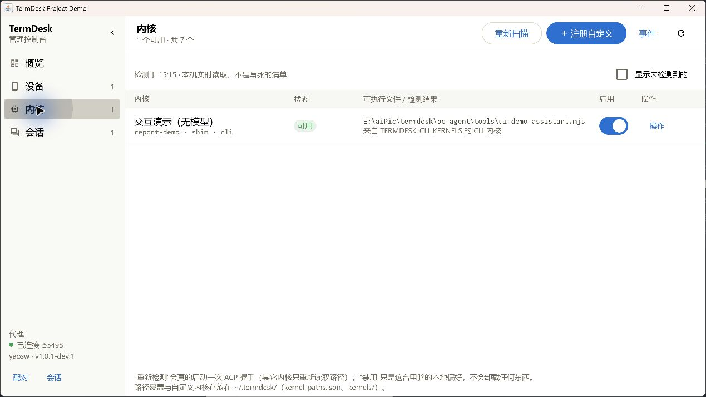
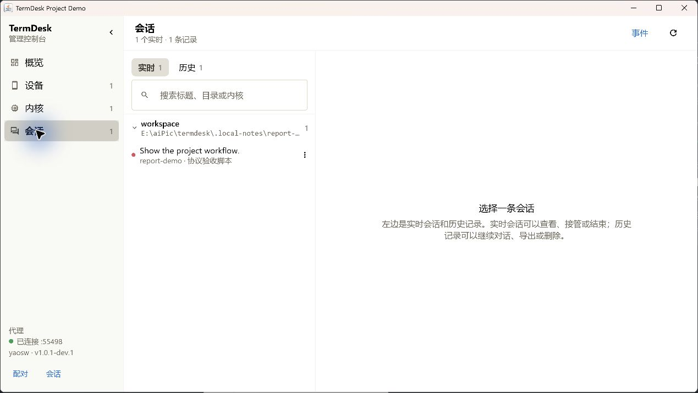

助手页只展示本轮注册的无模型演示入口。页面仍有偏开发者的解释性文案，后续应收敛为日常管理需要的检测时间、状态、原因与操作。

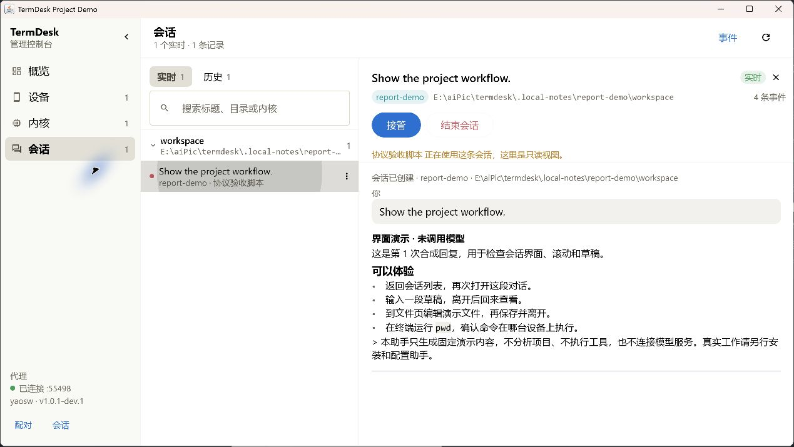

会话详情展示同一 Agent 的正文和控制权，当前由协议验收脚本持有，桌面处于只读观察状态。“结束会话”禁用；本次未点击接管、删除或其他破坏性操作。

## 八、部署、数据与安全边界

### 远程模式

电脑安装 Node.js 20+，安装 Agent 依赖后手动启动。局域网地址必须从手机可达；电脑自身的 127.0.0.1 不能直接当成普通手机网络地址。公网使用受信任 TLS 隧道或单独部署的 Relay，不把未加密的 ws/http 描述为端到端加密。

### 手机本机模式

运行环境是独立载荷，按大小和 SHA-256 校验后解包，再做 shell 健康检查；App 嵌入的 Agent 与工具载荷分别更新。安装运行环境不等于安装 AI 助手，也不等于已经有可用模型账号。现有 ARM64 载荷和 OEM 后台策略需要真机验证，x86_64 模拟器不能替代。

默认 targetSdk 28 是执行私有目录内用户环境的明确取舍，带来侧载和平台兼容限制。提高 targetSdk 的替代构建会改变本机执行条件，不能为了版本数字直接提高后仍声称沙盒能力不变。

### 数据与权限

- 设备凭据独立保存；吊销或移除会使匹配的现有连接失效，并拒绝后续认证和文件/载荷请求。
- 文件 API 校验允许目录及真实路径/符号链接边界；shell 仍拥有宿主用户权限，本项目不是恶意代码强隔离容器。
- 历史、草稿和待发信息保留在对应客户端/Agent 存储中；原生会话恢复交给助手，不靠拼接聊天正文冒充。
- 密钥不进入示例、截图或仓库；演示使用随机临时凭据、隔离目录和无模型助手，结束后恢复手机原有偏好。

## 九、本轮修复与验证

三位 GPT-6 Luna 子代理完成主要编程，主代理负责复核、集成、实际设备流程和材料整理。

| 问题 | 本轮改动 | 验证方式 |
|---|---|---|
| 固定供应商/模型 | 删除手机强制注入和代理个人默认路由；缺配置明确拒绝，第三方端点与 provider 校验 | DSH 路由与调用夹具，未调用真实模型 |
| 配置能力失真 | 不再自动声明百万上下文、固定输出和图像能力；YAML 标量安全转义 | 离线配置生成/拒绝用例，实际 SDK 接受条件另行核查 |
| 固定安装目录 | Windows PATH 和 npm bin 元数据发现 OpenCode，保留拒绝原因 | 隔离 Windows 入口夹具 |
| 固定系统工具路径 | 按宿主环境查找 Node 和进程树终止工具；保留拥有权 | 桌面工具路径与资源定位单测 |
| 固定窗口下限 | 初始和最小尺寸均受可用工作区限制 | 尺寸纯函数单测 |
| 构建输入/审批探针 | 输入 tar 显式指定；假助手使用相对路径和临时目录，增加实际断言 | 构建参数与审批往返回归 |
| 桌面分发 | App image 附 Agent 资源及生产依赖；CI 显式提供 JDK 21 | 资源检查、桌面测试与构建 |
| JVM 启动失败 | 发现精简运行时漏掉 java.net.http 等实际依赖，补入模块并增加打包预检 | 依赖分析、实际打包 JVM 的无界面检查及后续启动验收 |

### 本轮实际证据

- 完整 Agent 默认回归已实际执行，包含假助手、审批、多客户端、通知和中转链路。真实 Qoder 调用、平台不适用场景和可选完整载荷哈希有明确跳过，不能写成全平台、全助手实测通过。
- Android 单测及 debug APK 构建成功。OPPO 已以同一调试签名覆盖更新，未卸载或清除应用数据。
- 自动化完成工作台、会话发送、流式回复、文件编辑/保存、电脑终端及设置导航六个场景。后台观察端收到 12 条聊天事件，电脑文件重读确认保存成功。
- 录屏为 scrcpy 直接录制的 OPPO 实际屏幕，约两分钟，无音频；不是截图拼接视频。没有录制配对凭据页面。
- 原偏好文件的哈希在恢复后与备份一致；测试代理与本次 ADB 反向映射已停止/移除。实际手机号、账号和模型密钥没有进入演示数据。
- 桌面首次打包启动失败已实际暴露，不能用此前构建结果代替启动验收；最终结果单独记录于[本轮汇报](项目汇报-2026-10-18.md)。
- 修复后已对随包 JVM 做实际无界面启动，并打开原生程序检查概览、设备、助手和会话五个画面。桌面单测为 2 类 7 项，Android 为 13 类 116 项，均无失败；没有把这些检查扩大为全部平台/助手的功能认证。
- DSH npm 发布包 0.2.1-rc.2 的静态类型确认模型可仅提供 id；省略的能力由该 SDK 自己的 catalog/默认值处理。这不代表发现了模型能力，也不证明本机安装版相同或真实模型请求已恢复。

## 十、可重复演示与开发入口

自动化脚本为 [demo-walkthrough.mjs](../pc-agent/tools/demo-walkthrough.mjs)。必须明确设备序列号，不自动操作第一台设备；目标应预先安装相同签名的调试包、打开完成存储初始化并已允许调试。当前操作链使用 Windows PowerShell，适合 Windows 宿主。首次运行会私下备份偏好、启动仅回环监听的隔离 Agent、登记固定回复助手并配对；最终恢复偏好并关闭自身测试服务。

```powershell
node pc-agent/tools/demo-walkthrough.mjs --serial <目标设备> --phase run
```

可用 prepare / walkthrough / cleanup 分段供截图核查；脚本会拒绝覆盖尚未清理的会话。可选 scrcpy 参数生成设备端编码的视频；ADB、输出目录和私有状态目录均可明确指定。私有备份、随机凭据和日志不进入仓库，截图及脱敏验证摘要可随文档保存。

默认截图输出到 output/demo；录屏需显式提供官方 scrcpy 可执行文件，不会自动下载。示例：

```powershell
node pc-agent/tools/demo-walkthrough.mjs --serial <目标设备> --phase run --scrcpy <scrcpy路径> --video output/demo/walkthrough.mp4
```

本文的可编辑源是仓库内 Markdown；[PDF 导出脚本](../tools/build-project-report.py) 使用 ReportLab、Pillow 和可嵌入的中文字体生成同内容说明书，默认输出到 output/pdf。其他系统可通过 --font 指定字体。本轮 PDF 与录像为本机交付物，未上传发行页。

```powershell
npm --prefix pc-agent test
.\android\gradlew.bat -p android :app:testDebugUnitTest :app:assembleDebug
.\desktop\gradlew.bat -p desktop test createDistributable
node tools/verify-desktop-package.mjs
```

桌面打包预检读取实际精简运行时模块，和应用/依赖的 jdeps 结果比较，并检查所附 Agent 资源。它先于打开窗口使用，避免再次把一个构建成功但无法启动的程序交给用户。

## 十一、当前进度与下一步

远程模式的手机交互、协议、文件和终端已有可运行闭环，手机用户环境与动态助手接入也有实现及历史验收。电脑端方向已收敛到管理器。项目的下一阶段重点是配置来源、设备作用域和实际使用质量，而非继续增加重复界面。

| 顺序 | 目标 | 完成标准 |
|---|---|---|
| 1 | 桌面分发可靠性 | 原生启动、依赖、Agent 资源与 Node 前置条件明确；不靠完整开发 JDK 掩盖缺模块 |
| 2 | 手机 Agent 配置 | 目标、作用域和生效时机清楚；脱敏读写、失败回滚；以真实接口支持为边界 |
| 3 | 设备作用域与通知 | 双电脑缓存/队列不串数据，多手机独立确认，保留已有广播和吊销回归 |
| 4 | 日常操作质量 | 危险操作确认、目录一致性、大字号、长标题、键盘/返回、弱网和长期后台 |
| 5 | 助手与平台认证 | 分版本验证登录、恢复、审批、取消和文件产物；真实模型测试独立许可并记录 |

完整剩余工作见[待办清单](待办清单.md)。历史记录与 34 张原始截图保存在归档区；用户最初的设计稿仍在原位置。说明书、汇报、演示证据和实际测试结果共同描述当前项目，规划不替代实现，截图不替代功能验证。
